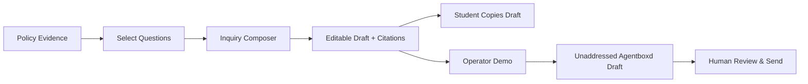
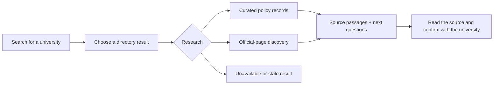

<div align="center">

# Second Chance

### The aid offer is only part of the story

Second Chance helps international students find the financial aid details they need before committing to a US university.

[**Explore the live app**](https://second-chance-drab.vercel.app/) · [How it works](#how-it-works) · [Run locally](#run-locally) · [API contract](docs/CONTRACT.md)

[](https://react.dev/)
[](https://fastapi.tiangolo.com/)
[](https://vite.dev/)
[](https://second-chance-drab.vercel.app/)

Built for **EvoHacks II** · Projects for Social Good

</div>

---

## Why Agentboxd matters for Second Chance

Finding a hidden policy detail is only half the battle. When an international student discovers that a university requires financial aid applications at the time of admission, their immediate next question is: *what do I write to the university?*

**Agentboxd bridges the gap between policy research and real-world institutional communication.** Instead of leaving students with a blank screen, Second Chance uses an Agentboxd-powered workflow to transform source-linked evidence into structured, editable inquiry drafts with clear safety boundaries.



- **Grounding in real sources:** The draft cites the exact university source URLs found during research so admissions counselors know precisely which policy is being referenced.
- **Privacy guardrails:** The composer reminds applicants never to attach tax forms, passwords, bank account details, or sensitive financial documents to preliminary inquiries.
- **Human-in-the-loop review:** In the team operator workflow, drafts are created unaddressed in Agentboxd (`POST /v1/inboxes/:id/drafts`). No email is ever sent or scheduled automatically without human review.

See the [Agentboxd integration architecture and safety model](docs/AGENTBOXD.md) for full details.

---

## The story

I was excited when I got into Loyola. The offer came with 50% financial aid. It sounded like a chance I could finally take. Then I worked out what was left to pay: **more than ₹20 lakh a year**.

I remember trying to understand the conditions on my own. The details were spread across university pages, and a generous percentage still left a cost I could not ignore.

We built **Second Chance** to help other students find the details and ask better questions earlier. The app does not calculate your final cost or decide whether you will receive aid.

---

## What you can do

| | |
|---|---|
| **Find a university** | Search by name and choose the matching institution. |
| **Read the evidence** | Explore source-linked passages, review status and retrieval details when available. |
| **See what to check** | Review next steps and questions relevant to the information returned. |
| **Compose an inquiry** | Prepare an editable inquiry email citing official sources, with clear safety guardrails. |
| **Take the questions with you** | Copy or export the checklist before speaking with a university. |

> [!IMPORTANT]
> Second Chance is a research starting point, not an admission, aid or cost decision. Policies can change, and a snippet may not contain every condition. Check the original source and confirm details directly with the university.

## How it works



Some universities have curated records. For others, College Scorecard can help find the institution, and Tavily can help locate pages on its domain. The API extracts passages and returns their sources and review details. Results can be **fresh**, **cached**, **stale** or **unavailable**. Automatically discovered passages are marked unreviewed.

> We do not cover every policy. Without the optional API keys, discovery is limited to curated records. Even with keys, a university may have no usable result.

### Built with

**React + Vite** for the interface, **FastAPI + Python** for the API, **SQLite** for the evidence cache, and **Vercel** for deployment. The optional directory and discovery integrations use College Scorecard and Tavily.

---

## Run locally

**Requirements:** Python 3.13, Node.js 20 and npm. These versions match the repository's CI configuration.

### 1. Start the backend

```bash
git clone https://github.com/AtulACleaver/second-chance.git
cd second-chance
cp .env.example .env

cd backend
python -m venv .venv
source .venv/bin/activate       # Windows PowerShell: .venv\Scripts\Activate.ps1
pip install -r requirements.txt
python -m uvicorn app.main:app --reload --port 8000
```

API health: [http://127.0.0.1:8000/api/health](http://127.0.0.1:8000/api/health) · API docs: [http://127.0.0.1:8000/docs](http://127.0.0.1:8000/docs)

### 2. Start the frontend

Open a second terminal from the repository root:

```bash
cd frontend
npm ci
npm run dev
```

Open [http://localhost:5173](http://localhost:5173). Vite proxies `/api` requests to the local backend.

### Optional configuration

Edit the root `.env` file. Never commit API keys.

| Variable | Purpose |
|---|---|
| `SCORECARD_API_KEY` | Enables broader university directory searches. |
| `TAVILY_API_KEY` | Enables discovery of official pages for non-curated schools. |
| `CACHE_PATH` | Sets the local SQLite cache path. |
| `ENABLE_OPERATOR_API` | Enables private operator endpoints (`/api/operator`) for testing (`true` or `false`). |
| `OPERATOR_TOKEN` | Bearer token protecting operator endpoints. |
| `AGENTBOXD_API_KEY` | API key for Agentboxd draft integration. |
| `AGENTBOXD_INBOX_ID` | Designated inbox ID for test inquiry drafts. |

The app can run without the external keys, defaulting to curated records and local operations. See [`.env.example`](.env.example) for the full list of settings.

### Run the checks

```bash
# From the repository root, with the backend virtual environment active
(cd backend && python -m pytest -q)
python evaluation/run.py
python evaluation/agentboxd_checks.py

# Frontend production build
(cd frontend && npm run build)
```

The evaluation uses fictional profiles and boundary checks. It is a regression test, not a measure of real-world financial aid accuracy. See [evaluation results](evaluation/RESULTS.md).

---

## Under the hood

| Path | Purpose |
|---|---|
| [`frontend/`](frontend/) | React interface and API client |
| [`backend/app/`](backend/app/) | Directory lookup, research, policy records and cache |
| [`api/`](api/) | Vercel serverless entry point |
| [`evaluation/`](evaluation/) | Fictional profile fixtures and evaluation runner |
| [`docs/CONTRACT.md`](docs/CONTRACT.md) | API request and response contract |

**API at a glance:** `GET /api/health` checks service health, `GET /api/schools?q=...` searches the directory, and `POST /api/research` returns source-linked research for a selected school. See the [contract](docs/CONTRACT.md) for request fields and response states.

### Agentboxd integration

Second Chance connects student research to institutional follow-up through a two-tier workflow:

1. **Client-side inquiry composer:** An in-browser tool that formats selected policy questions into an editable email draft citing verified official source URLs, complete with safety guardrails (reminding applicants never to share financial documents, passwords, or SSNs).
2. **Protected operator portal:** A private, authenticated team demo workflow (`/api/operator`) that creates unaddressed, unsent drafts in Agentboxd (`POST /v1/inboxes/:id/drafts`) for mandatory human operator review. It is disabled by default, requires a Bearer token, and never sends email automatically.

For the security boundaries, API contract, and multi-user roadmap, see [Agentboxd documentation](docs/AGENTBOXD.md).

## Team

| | Focus |
|---|---|
| [Atul](https://github.com/AtulACleaver) | Backend and project direction |
| [Aryan](https://github.com/aryansc) | Integration, testing and coordination |
| [Shashank](https://github.com/ssp0009) | Frontend and design |

Built for EvoHacks II. See [AI-USE.md](AI-USE.md) for the project's AI-use and contribution disclosure.
