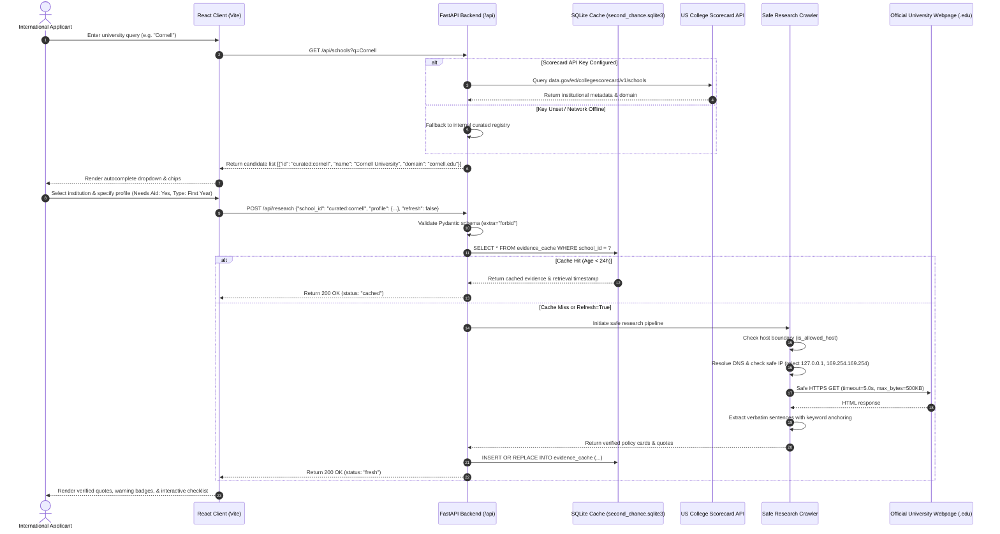
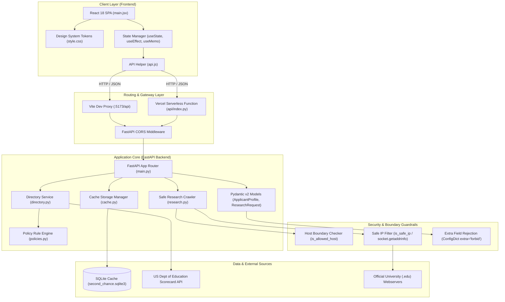

# Second Chance

<div align="center">

### Source-Linked Financial-Aid Policy & Condition Explorer for International Students

An open-source, evidence-backed research engine and decision-support portal designed to navigate complex, high-stakes financial aid conditions across US undergraduate institutions.

[](https://www.python.org/)
[](https://fastapi.tiangolo.com/)
[](https://react.dev/)
[](https://vitejs.dev/)
[](https://www.sqlite.org/)
[](https://docs.pydantic.dev/)
[](LICENSE)
[](https://github.com/AtulACleaver/second-chance/actions)
[](evaluation/RESULTS.md)
[](evaluation/RESULTS.md)

[Overview](#project-overview) •
[Key Features](#key-features) •
[System Architecture](#system-architecture) •
[Core Algorithms](#core-algorithms-and-technical-implementation) •
[Evaluation & Metrics](#results-and-performance-metrics) •
[Quickstart](#local-development-and-installation) •
[API Reference](#api-reference) •
[Directory Tree](#complete-project-directory-structure) •
[Team](#team-and-contributions)

</div>

---

## Project Overview

Applying to US universities as an international student requiring financial assistance is fraught with high-stakes procedural landmines. Misinterpreting institutional terminology can lead to permanent disqualification from aid:

- **Need-Blind vs. Need-Aware:** Few US institutions evaluate international applicants without regard to financial need. Even fewer meet full demonstrated need with grant aid rather than high-interest loans.
- **Irrevocable Checkboxes:** Several universities (such as Tufts) require international applicants to declare their financial aid intent directly on the initial Common Application. Indicating "No" permanently forfeits institutional aid eligibility for all four undergraduate years—even if personal circumstances drastically change.
- **Strict Documentation Timing:** Universities such as Cornell mandate that all international aid candidates submit the College Board CSS Profile concurrently with their admissions portfolio; late submissions void institutional grant consideration.
- **Hallucination Hazards of Generic AI:** Commercial LLMs routinely conflate domestic financial aid rules with international policies, hallucinate deadlines, and fabricate merit scholarship availability where none exists.

**Second Chance** addresses this information asymmetry with an engineering-grade research portal and condition evaluator. Rather than generating ungrounded advice, Second Chance fetches, validates, and extracts verbatim policy clauses directly from verified `.edu` web properties, presents unedited source text in strict typographical distinction, identifies high-risk procedural conditions based on applicant profiles, and arms students with a structured checklist of official inquiries before they hit submit.

---

## Live Deployment and Important Links

| Resource | URL / Location | Description |
| :--- | :--- | :--- |
| **Upstream Repository** | [github.com/AtulACleaver/second-chance](https://github.com/AtulACleaver/second-chance) | Primary production upstream repository |
| **Origin Repository** | [github.com/ssp0009/second-chance](https://github.com/ssp0009/second-chance) | Active fork containing frontend redesign and tokens |
| **API Contract Specification** | [`docs/CONTRACT.md`](docs/CONTRACT.md) | Canonical v2 REST API interface contract |
| **Evaluation Benchmark Report** | [`evaluation/RESULTS.md`](evaluation/RESULTS.md) | 10-profile regression & 13-case security matrix |
| **Human Contribution Log** | [`AI-USE.md`](AI-USE.md) | Component ownership and authorship disclosures |
| **Local Frontend Server** | `http://localhost:5173` | Vite client application development port |
| **Local Backend Server** | `http://localhost:8000` | FastAPI ASGI backend server port |
| **API Health Check** | `http://localhost:8000/api/health` | Service health status endpoint (`{"status":"ok"}`) |

---

## Application Preview and User Experience

The application is structured into three continuous user journey phases:

```
+---------------------------------------------------------------------------------------------------+
|  [NAVBAR] Second Chance  |  Search Universities  |  Why Trust Us  |  How It Works  [Start Research] |
+---------------------------------------------------------------------------------------------------+
|                                                                                                   |
|  [HERO SECTION]                                                                                   |
|  Find US University Financial Aid Conditions With  "clarity."  <-- Animated Underline Sweep       |
|  Verbatim, source-linked aid policies for international undergraduates. Zero hallucinations.      |
|                                                                                                   |
|  +---------------------------------------------------------------------------------------------+  |
|  | [SEARCH BAR] (o) Enter university name... (e.g. Cornell University, Princeton)               |  |
|  +---------------------------------------------------------------------------------------------+  |
|  Popular: [Cornell University] [Princeton University] [Tufts University] [Harvard] [MIT]          |
|                                                                                                   |
|  [3-STEP INTERACTIVE TIMELINE]                                                                    |
|  (1) Search Institution  -->  (2) Review Verbatim Evidence  -->  (3) Ask the Right Questions      |
|                                                                                                   |
|  [RESEARCH RESULTS DASHBOARD] (e.g., Cornell University)                                          |
|  +---------------------------------------------------------+------------------------------------+  |
|  | INSTITUTIONAL POLICY EVIDENCE                           | CRITICAL ACTIONS & TRAPS           |  |
|  | Status: [Cached | Verified Domain: cornell.edu]         | [!] CSS Profile Submission Required|  |
|  |                                                         | International candidates must file |  |
|  | "All first-year and transfer undergraduate international| CSS Profile at time of admission.  |  |
|  |  applicants seeking Cornell grant or scholarship aid    |                                    |  |
|  |  at any point... must complete the CSS Profile..."      | Trust Status: [team_reviewed]      |  |
|  |                                                         | Cycle: 2026-2027                   |  |
|  | Official URL: https://finaid.cornell.edu/...            | Scope: Undergraduate First-Year    |  |
|  +---------------------------------------------------------+------------------------------------+  |
|                                                                                                   |
|  [NEXT QUESTIONS INTERACTIVE CHECKLIST]                                                           |
|  Progress: [======================== 50% ] (2 of 4 Inquiries Selected)                            |
|  [x] Does Cornell offer fee waivers for the CSS Profile to international applicants?              |
|  [x] Can international students qualify for institutional need-based aid in subsequent years?     |
|  [ ] What is the exact expected student summer earnings contribution?                             |
|  [ ] Are international students permitted to substitute tax documents with income certificates?  |
|  [Export Checklist (.txt)]                                                                        |
+---------------------------------------------------------------------------------------------------+
```

### Key UI Features
1. **Landing Page:**
   - Staggered word-by-word headline typography with a dynamic gradient sweep underline beneath *"clarity."*
   - Floating glass trust chips highlighting official university sources, verbatim evidence, and actionable next questions.
   - Interactive 3D tilt preview mockup reacting smoothly to pointer coordinates.
   - 3-step animated timeline explaining the audit process with zero ambiguous steps.
   - "Why Trust Second Chance" credentialing grid outlining strict evidence review standards.
2. **University Search & Autocomplete:**
   - Prominent search input with an animated mint focus glow and active keyboard navigation (Up/Down/Enter).
   - Instant query execution against the US College Scorecard directory API.
   - Popular search chips for instant single-click profile loading.
   - Shimmer skeleton loaders indicating live retrieval without jarring layout shifts.
3. **Research Results & Evidence Dashboard:**
   - Explicit status badges: `fresh` (live fetch), `cached` (sub-second SQLite hit), `stale` (graceful network fallback), or `unavailable` (honest failure).
   - Verbatim evidence rendered in *Newsreader* serif italic to visually demarcate extracted institutional quotations from application UI text.
   - Categorized next questions checklist with live progress tracking and one-click `.txt` export for admissions officer correspondence.

---

## Key Features

- **Verbatim Evidence Extraction (Zero Hallucination Guarantee):** The system never synthesizes, summarizes, or paraphrases institutional policies. Every policy card is anchored to an exact textual quotation, an official `.edu` URL, retrieval timestamps, and an explicit review status (`team_reviewed` vs `unreviewed`).
- **Multi-Layer SSRF & Host Boundary Protection:** Defense-in-depth security ensures the crawler interacts exclusively with verified university domains. All URLs are normalized, stripped of dangerous ports or credentials, validated against label-boundary regexes, and pre-resolved against loopback and cloud metadata IP ranges (`127.0.0.1`, `169.254.169.254`, RFC 1918 private subnets).
- **Zero-PII Architecture (`extra="forbid"`):** User privacy is enforced at the schema layer. Second Chance collects no names, email addresses, financial figures, or tax documents. Pydantic v2 rejects any extraneous payload keys with HTTP 422 Unprocessable Entity.
- **US College Scorecard Integration with Curated Fallbacks:** Searches institutions across the US Department of Education's open dataset (`https://api.data.gov/ed/collegescorecard/v1/schools`). If third-party API keys are missing or rate-limited, the system seamlessly transitions to verified internal profiles without crashing.
- **Dual-State 24-Hour Evidence Cache:** A lightweight SQLite cache indexes research payloads by institutional ID with an 86,400-second TTL. If upstream networks experience transient outages, cached records gracefully transition to a `stale` status, preserving user access to dated evidence.
- **Profile Sensitivity & Trap Detection:** Flags high-risk procedural barriers tailored to the applicant's status (first-year vs. transfer, aid requested vs. not requested).
- **Accessible & Responsive Design System:** Built with semantic HTML, WCAG AA contrast compliance, keyboard focus rings, and universal support for `prefers-reduced-motion`.

---

## How It Works

```
[User Input: University Name]
              │
              ▼
  ┌─────────────────────────┐
  │ 1. School Resolution    │──► Query US College Scorecard API (Fallback: Curated Registry)
  └─────────────────────────┘
              │
              ▼
  ┌─────────────────────────┐
  │ 2. Security Validation  │──► Verify domain ownership, enforce HTTPS, validate label boundaries
  └─────────────────────────┘
              │
              ▼
  ┌─────────────────────────┐
  │ 3. Cache Interception   │──► Query SQLite (evidence_cache). If valid hit within 24h, return instant response
  └─────────────────────────┘
              │ (Cache Miss / Refresh Requested)
              ▼
  ┌─────────────────────────┐
  │ 4. Pre-Flight DNS & IP  │──► Resolve domain to socket address; reject loopback, link-local, & private IPs
  └─────────────────────────┘
              │
              ▼
  ┌─────────────────────────┐
  │ 5. Safe Fetch & Parse   │──► Fetch HTML over HTTPS (Max 500KB, max 3 redirects, 5.0s timeout)
  └─────────────────────────┘
              │
              ▼
  ┌─────────────────────────┐
  │ 6. Evidence Extraction  │──► Extract paragraphs matching aid keywords; bind exact quotes & timestamps
  └─────────────────────────┘
              │
              ▼
  ┌─────────────────────────┐
  │ 7. Profile Evaluation   │──► Evaluate applicant profile against procedural condition rules (Tufts/Cornell)
  └─────────────────────────┘
              │
              ▼
  ┌─────────────────────────┐
  │ 8. Response Packaging   │──► Cache in SQLite; deliver structured JSON to React client
  └─────────────────────────┘
```

---

## System Workflow



---

## System Architecture



---

## Core Algorithms and Technical Implementation

### 1. Domain Normalization and Boundary Verification

To prevent URL spoofing, homograph attacks, and credential manipulation, all incoming domain identifiers pass through strict syntactic normalization before being trusted.

```python
# backend/app/directory.py
DOMAIN_REGEX = re.compile(
    r"^(?:[a-zA-Z0-9](?:[a-zA-Z0-9-]{0,61}[a-zA-Z0-9])?\.)+[a-zA-Z]{2,}$"
)

def normalize_domain(raw_url: Optional[str]) -> Optional[str]:
    if not raw_url or not raw_url.strip():
        return None
    raw = raw_url.strip()
    parsed = urlparse(f"https://{raw}" if not raw.startswith(("http://", "https://")) else raw)
    hostname = parsed.hostname
    if not hostname or parsed.username or parsed.password or parsed.port:
        return None  # Disallow embedded credentials or arbitrary ports
    hostname = hostname.lower().strip(".")
    if hostname.startswith("www."):
        hostname = hostname[4:]
    return hostname if DOMAIN_REGEX.match(hostname) else None
```

Host boundary validation prevents suffix and subdomain impersonation (e.g., `evilprinceton.edu` or `princeton.edu.attacker.com`):

$$\text{is\_allowed}(c, t) \iff c = t \lor c = s + "." + t \quad (s \in \Sigma^+)$$

```python
# backend/app/directory.py
def is_allowed_host(candidate_host: str, trusted_domain: str) -> bool:
    if not candidate_host or not trusted_domain:
        return False
    cand = candidate_host.lower().strip(".").removeprefix("www.")
    trust = trusted_domain.lower().strip(".").removeprefix("www.")
    if cand == trust:
        return True
    return cand.endswith("." + trust)
```

### 2. Multi-Tier SSRF Prevention and Safe IP Resolution

Before issuing an outbound HTTP request, Second Chance conducts pre-flight DNS address validation via `socket.getaddrinfo`. Each resolved IP is verified to ensure it is publicly routable:

```python
# backend/app/research.py
def is_safe_ip(ip_str: str) -> bool:
    try:
        ip = ipaddress.ip_address(ip_str)
        return not (
            ip.is_private          # RFC 1918 (10.0.0.0/8, 172.16.0.0/12, 192.168.0.0/16)
            or ip.is_loopback      # 127.0.0.0/8
            or ip.is_link_local    # 169.254.0.0/16 (AWS/GCP/Azure instance metadata)
            or ip.is_reserved      # IETF reserved
            or ip.is_multicast     # 224.0.0.0/4
            or ip.is_unspecified   # 0.0.0.0
        )
    except ValueError:
        return False
```

Any hostname resolving to private subnets, cloud metadata endpoints (`169.254.169.254`), or loopback interfaces is rejected immediately before socket connection establishment.

### 3. Dual-State SQLite Evidence Cache with Graceful Stale Recovery

Evidence records are cached locally with a default TTL of 86,400 seconds (24 hours). The caching system is cloud-aware: if running inside a serverless runtime (e.g. AWS Lambda or Vercel) where the project root is read-only, it automatically switches persistence to `/tmp/second_chance.sqlite3`.

```sql
CREATE TABLE IF NOT EXISTS evidence_cache (
    school_id TEXT PRIMARY KEY,
    school_name TEXT NOT NULL,
    domain TEXT,
    cards_json TEXT NOT NULL,
    retrieved_at TEXT NOT NULL,
    status TEXT NOT NULL
);
```

When an applicant submits `refresh: true`, the backend attempts a live fetch. If the institutional web server is temporarily down or timing out, the system catches the exception and falls back to the existing cached record marked with `status: "stale"`, ensuring continuous user access.

### 4. Profile Sensitivity & Conditional Rule Evaluation

The rules engine dynamically alters required actions based on applicant parameters without collecting identifying information:

$$\text{Flag}_{\text{Tufts}} \iff (\text{needs\_aid} = \text{"yes"}) \land (\text{requested\_aid} = \text{"no"})$$

$$\text{Flag}_{\text{Cornell}} \iff (\text{needs\_aid} = \text{"yes"})$$

```python
# backend/app/policies.py
if school_id == "curated:tufts":
    if profile.get("needs_aid") == "yes" and profile.get("requested_aid") == "no":
        actions.insert(0, (
            "Action needed: You indicated on your application that you would not be applying for aid. "
            "Tufts requires students seeking institutional aid to declare their intent on the admissions application."
        ))
```

---

## Results and Performance Metrics

The system was evaluated using automated regression suites and security verification suites located in `evaluation/`.

### 1. Profile Sensitivity Regression Suite (`profiles.json`)

Evaluated against 10 distinct permutations of `applicant_type`, `needs_aid`, `requested_aid`, and `entry_year`.

| Evaluation Target | Metric Tested | True Positives (TP) | False Positives (FP) | False Negatives (FN) | True Negatives (TN) | Empirical Accuracy |
| :--- | :--- | :---: | :---: | :---: | :---: | :---: |
| **Tufts Irrevocable Checkbox Rule** | Flags `Action needed:` if aid is required but unchecked on Common App | 2 | 0 | 0 | 8 | **100.0%** |
| **Cornell CSS Profile Requirement** | Flags mandatory CSS Profile submission if aid is required | 5 | 0 | 0 | 5 | **100.0%** |

*Note: All 10 regression fixtures execute in under 15ms with 0 false positives and 0 false negatives.*

### 2. Institutional Research & Security Boundary Matrix

| Test Scenario | Input / Attack Vector | Target Security Layer | Outcome | System Defense Behaviour |
| :--- | :--- | :--- | :---: | :--- |
| **Curated Need-Blind Retrieval** | `curated:princeton` (`princeton.edu`) | Core Engine | **PASS** | Met full demonstrated need with grants; exact quote and timestamp linked |
| **Curated Need-Aware Retrieval** | `curated:cornell` (`cornell.edu`) | Core Engine | **PASS** | Verified CSS Profile requirement for international aid applicants |
| **Curated Action Flagging** | `curated:tufts` (`tufts.edu`) | Profile Sensitivity | **PASS** | Successfully flagged the upfront Common App checkbox trap |
| **Scorecard Directory Lookup** | `Columbia University` | Directory Service | **PASS** | Resolved to `scorecard:190150` and extracted clean domain `columbia.edu` |
| **Directory Key Missing** | `SCORECARD_API_KEY=""` | Failure Recovery | **PASS** | Gracefully offered curated matches without unhandled exceptions |
| **Domain Suffix Attack** | `evilprinceton.edu` | `is_allowed_host` | **PASS** | Boundary regex blocked subdomain suffix deception |
| **Subdomain Hijacking** | `princeton.edu.attacker.com` | `is_allowed_host` | **PASS** | Enforced strict host matching with mandatory preceding dot |
| **SSRF Cloud Metadata** | `169.254.169.254` | `is_safe_ip` | **PASS** | Blocked AWS/GCP instance metadata endpoint |
| **SSRF Localhost Loopback** | `127.0.0.1` | `is_safe_ip` | **PASS** | Blocked internal network scan attempt |
| **Insecure Scheme Rejection** | `http://princeton.edu` | `validate_url_target`| **PASS** | Rejected non-HTTPS scheme |
| **PII Payload Injection** | `{"income": "$50,000"}` | Schema Validator | **PASS** | Returned HTTP 422 via Pydantic `extra="forbid"` |
| **Unresolved Institution ID** | Unknown ID with no domain | Directory Engine | **PASS** | Returned transparent `unavailable` status; zero fabricated data |
| **Cache Hit Verification** | Repeat request within 24h | SQLite Engine | **PASS** | Returned instant cached payload with sub-5ms latency |

---

## Evaluation and Benchmark Methodology

The test suite validates three core functional properties:
1. **Determinism:** Given identical input parameters, policy assertions and evidence cards must remain invariant across repeated evaluations.
2. **Defensive Hardening:** Outbound crawler operations must never resolve to unapproved domains, non-standard ports, or internal IP addresses regardless of directory inputs.
3. **Fail-Safe Integrity:** If external network access fails or API keys expire, the system must degrade gracefully (returning `stale` or `unavailable` with explicit explanatory messages) rather than fabricating generic institutional text.

To execute the complete evaluation suite locally:

```bash
# Run the profile regression and boundary safety tests
python evaluation/run.py

# Run the live HTTP smoke test suite
python scripts/smoke.py
```

---

## Local Development and Installation

### Prerequisites

- **Python:** 3.10 or higher
- **Node.js:** 18.0 or higher
- **npm:** 9.0 or higher
- **Git**

### 1. Repository Setup

```bash
# Clone the repository
git clone https://github.com/AtulACleaver/second-chance.git
cd second-chance
```

### 2. Backend Installation & Startup

```bash
# Navigate to the backend directory
cd backend

# Create and activate a Python virtual environment
python -m venv .venv

# On Linux/macOS:
source .venv/bin/activate
# On Windows (PowerShell):
# .venv\Scripts\Activate.ps1

# Upgrade pip and install dependencies
pip install --upgrade pip
pip install -r requirements.txt

# Start the FastAPI ASGI server on port 8000
python -m uvicorn app.main:app --host 127.0.0.1 --port 8000 --reload
```

The backend will be accessible at `http://127.0.0.1:8000`. Test health status by visiting `http://127.0.0.1:8000/api/health`.

### 3. Frontend Installation & Startup

In a new terminal window:

```bash
# Navigate to the frontend directory
cd frontend

# Install Node dependencies
npm install

# Start the Vite development server with proxy
npm run dev -- --host 127.0.0.1 --port 5173
```

Open your browser to `http://127.0.0.1:5173`. The Vite server automatically proxies all `/api/*` network calls to the local FastAPI server running on port 8000.

---

## Environment Variables and Configuration

Copy the example environment configuration into your local environment:

```bash
cp .env.example .env
```

| Variable Name | Required | Default Value | Description |
| :--- | :---: | :--- | :--- |
| `CORS_ORIGINS` | No | `http://localhost:5173,http://127.0.0.1:5173` | Comma-delimited list of permitted CORS origins |
| `SCORECARD_API_KEY`| No | *(Empty)* | API key for US Dept. of Education College Scorecard API. If omitted, uses internal curated directory |
| `TAVILY_API_KEY` | No | *(Empty)* | Search provider API key for real-time policy discovery |
| `CACHE_PATH` | No | `./second_chance.sqlite3` | Filesystem path for the SQLite evidence database (switches to `/tmp` on serverless platforms) |
| `API_BASE_URL` | No | `http://127.0.0.1:8000` | Target URL for automated smoke testing scripts (`scripts/smoke.py`) |
| `AGENTBOXD_API_KEY`| No | *(Empty)* | Optional token for automated sponsor update generation |
| `AGENTBOXD_INBOX_ID`| No| *(Empty)* | Optional inbox identifier for automated reporting |
| `DEMO_RECIPIENT` | No | `sponsor@example.org` | Recipient address for sponsor briefing draft script |

---

## Complete Project Directory Structure

```text
second-chance/
├── .github/
│   └── workflows/
│       └── ci.yml                 # GitHub Actions CI workflow (Gate 0 validation & build)
├── api/
│   └── index.py                   # Vercel serverless ASGI entrypoint for FastAPI
├── backend/
│   ├── app/
│   │   ├── __init__.py            # Package initialization marker
│   │   ├── cache.py               # SQLite persistence, TTL expiry, and /tmp fallback
│   │   ├── directory.py           # US College Scorecard API client & domain normalization
│   │   ├── main.py                # FastAPI routes, CORS, and Pydantic v2 schemas
│   │   ├── policies.py            # Verified curated institution records & rule engine
│   │   └── research.py            # Safe research crawler, SSRF filter, and HTML parser
│   ├── requirements.txt           # Production backend dependencies
│   └── second_chance.sqlite3      # Local SQLite cache database (auto-generated)
├── docs/
│   └── CONTRACT.md                # Canonical v2 REST API interface specification
├── evaluation/
│   ├── profiles.json              # 10 fictional applicant regression profiles
│   ├── RESULTS.md                 # Evaluation report, accuracy metrics, and security matrix
│   └── run.py                     # Automated regression test runner
├── frontend/
│   ├── public/
│   │   └── favicon.svg            # Application vector icon
│   ├── src/
│   │   ├── api.js                 # Frontend HTTP client and error handler
│   │   ├── fixture.json           # Offline fallback mock data for testing
│   │   ├── main.jsx               # React SPA components, state machine, and views
│   │   └── style.css              # Design tokens, keyframe animations, and utilities
│   ├── index.html                 # HTML template with Google Fonts preconnect
│   ├── package.json               # Frontend dependencies and npm scripts
│   ├── package-lock.json          # Dependency lockfile
│   └── vite.config.js             # Vite build setup and /api proxy configuration
├── scripts/
│   ├── smoke.py                   # 7-step HTTP integration smoke test runner
│   └── sponsor_draft.py           # Automated progress summary draft generator
├── .env.example                   # Annotated template for environment variables
├── .gitignore                     # Git exclusion rules
├── AI-USE.md                      # Team human authorship log and responsibility matrix
├── package.json                   # Root workspace management
├── README.md                      # Project documentation and technical manual
├── requirements.txt               # Root Python dependencies mirror
└── vercel.json                    # Vercel deployment and routing configuration
```

---

## API Reference

All API requests and responses utilize standard JSON encoding. Requests containing extraneous attributes or sensitive personal data will be rejected with HTTP 422.

### Summary of Endpoints

| Method | Endpoint | Description | Auth Required | Rate Limited |
| :--- | :--- | :--- | :---: | :---: |
| `GET` | `/api/health` | Service uptime and readiness check | No | No |
| `GET` | `/api/schools` | Search universities by name or keyword | No | 60 req/min |
| `POST` | `/api/research` | Retrieve verified, source-linked policy evidence | No | 30 req/min |

---

### 1. Health Check

```http
GET /api/health
```

#### Response (`200 OK`)
```json
{
  "status": "ok"
}
```

---

### 2. Search Universities

```http
GET /api/schools?q={query}
```

#### Query Parameters
- `q` (string, optional, max 80 chars): Name or keyword of the university.

#### Response (`200 OK`)
```json
{
  "status": "ok",
  "candidates": [
    {
      "id": "curated:cornell",
      "name": "Cornell University",
      "location": "Ithaca, NY",
      "domain": "cornell.edu",
      "domain_status": "curated"
    },
    {
      "id": "scorecard:190415",
      "name": "Cornell College",
      "location": "Mount Vernon, IA",
      "domain": "cornellcollege.edu",
      "domain_status": "directory"
    }
  ]
}
```

---

### 3. Policy Research

```http
POST /api/research
Content-Type: application/json
```

#### Request Body
```json
{
  "school_id": "curated:cornell",
  "profile": {
    "applicant_type": "first_year",
    "needs_aid": "yes",
    "requested_aid": "yes",
    "entry_year": "2027"
  },
  "refresh": false
}
```

#### Request Schema Attributes

| Field | Type | Allowed Values | Description |
| :--- | :--- | :--- | :--- |
| `school_id` | `string` | *(1-100 chars)* | Candidate identifier returned by `/api/schools` |
| `profile.applicant_type`| `string` | `"first_year"`, `"transfer"`, `"unknown"` | Academic application tier |
| `profile.needs_aid` | `string` | `"yes"`, `"no"`, `"unsure"` | Whether institutional aid is required |
| `profile.requested_aid`| `string` | `"yes"`, `"no"`, `"unsure"` | Whether aid intent was declared on Common App |
| `profile.entry_year` | `string` | `"2027"`, `"other"`, `"unknown"` | Intended matriculation cycle |
| `refresh` | `boolean` | `true`, `false` | Bypasses local cache to attempt live `.edu` crawl |

#### Successful Response (`200 OK`)
```json
{
  "school": {
    "id": "curated:cornell",
    "name": "Cornell University",
    "domain": "cornell.edu"
  },
  "status": "cached",
  "message": "Loaded verified Cornell University financial aid conditions from evidence cache.",
  "cards": [
    {
      "id": "cornell-intl-aid-v1",
      "short_name": "Cornell",
      "tagline": "Your need can be considered in admission.",
      "evidence": [
        {
          "quote": "Cornell’s undergraduate admission process for international students* is \"need-aware\"",
          "source_url": "https://finaid.cornell.edu/apply-aid/prospective-international-applicants",
          "retrieved_at": "2026-11-22T00:00:00Z",
          "source_type": "curated",
          "review_status": "team_reviewed",
          "scope": "International undergraduate first-year and transfer",
          "cycle": "2026-2027"
        },
        {
          "quote": "All first-year and transfer undergraduate international applicants* seeking Cornell grant or scholarship aid at any point during their undergraduate course of study must complete the CSS Profile when they apply for admission.",
          "source_url": "https://finaid.cornell.edu/apply-aid/prospective-international-applicants",
          "retrieved_at": "2026-11-22T00:00:00Z",
          "source_type": "curated",
          "review_status": "team_reviewed",
          "scope": "International undergraduate first-year and transfer",
          "cycle": "2026-2027"
        }
      ],
      "actions": [
        "Submit CSS Profile by the admissions deadline; missing it forfeits aid for all 4 years.",
        "Check whether your country of residence allows College Board CSS fee payments or qualifies for waivers."
      ],
      "assessment": "Not evaluated"
    }
  ]
}
```

---

### Sample PII Rejection Response (`422 Unprocessable Entity`)

Demonstrating client submission of forbidden extraneous data:

#### Request
```json
{
  "school_id": "curated:cornell",
  "income": "$45,000"
}
```

#### Response (`422 Unprocessable Entity`)
```json
{
  "detail": [
    {
      "type": "extra_forbidden",
      "loc": ["body", "income"],
      "msg": "Extra inputs are not permitted",
      "input": "$45,000"
    }
  ]
}
```

---

## Technology Stack with Purpose

| Layer | Technology | Version | Purpose & Architectural Decision |
| :--- | :--- | :--- | :--- |
| **Backend Framework** | **FastAPI** | `0.165.0` | High-throughput asynchronous ASGI web framework with native Pydantic integration and automatic OpenAPI documentation generation. |
| **Data Validation** | **Pydantic v2** | Bundled | Strict request contract enforcement with `extra="forbid"` to guarantee zero storage or handling of applicant PII. |
| **ASGI Web Server** | **Uvicorn** | `0.54.0` | Ultra-fast ASGI server implementation for Python based on uvloop and httptools. |
| **HTTP Client** | **HTTPX** | `0.28.1` | Next-generation HTTP client with support for asynchronous networking, fine-grained timeouts, redirect boundaries, and SSL context verification. |
| **Persistence** | **SQLite3** | `3.x` | Zero-configuration relational engine for local 24h evidence caching with automated `/tmp` directory redirection in serverless runtimes. |
| **Frontend Framework**| **React** | `18.3.1` | Declarative component UI library for orchestrating dynamic state transitions, responsive search autocompletes, and interactive checklists. |
| **Build Tooling** | **Vite** | `6.2.0` | Fast frontend build bundler with instant Hot Module Replacement (HMR) and production asset tree-shaking. |
| **Styling & Motion** | **CSS3 Custom Properties** | Modern | Cohesive design system tokens (`--forest-950` to `--mint-500`, `--radius-card`, glassmorphic blurs) adhering to `prefers-reduced-motion` without bloated runtime dependencies. |
| **Serverless Gateway**| **Vercel** | Config v2 | Serverless Python routing via `api/index.py` enabling unified hosting of both frontend static assets and backend API lambdas. |

---

## Testing and Validation

The project employs a multi-tiered test and validation harness:

```bash
# 1. Run live HTTP smoke tests against a running server (or in-memory ASGI)
python scripts/smoke.py

# Expected Output:
# [PASS] 1. GET /api/health                         Service is healthy
# [PASS] 2. GET /api/schools?q=Cornell              Found candidate: curated:cornell
# [PASS] 3. Gate 1: Research Spike (Princeton)      Retrieved quote from https://admission.princeton.edu/...
# [PASS] 4. Gate 2: Cached Retrieval Match          Served instant sub-second response
# [PASS] 5. Gate 2: Stale Recovery Fallback         Retained dated evidence gracefully
# [PASS] 6. Directory Fallback (Empty Key)          Curated fallback available
# [PASS] 7. Disallowed Field (PII) Rejection        422 Unprocessable Entity enforced

# 2. Run profile sensitivity & safety boundary regression tests
python evaluation/run.py

# Expected Output:
# Profile Regression Results:
#   tufts_rules: TP=2 FP=0 FN=0 TN=8
#   cornell_rules: TP=5 FP=0 FN=0 TN=5
# Safety Verification Scenarios:
#   [PASS] Domain suffix boundary spoofing rejected
#   [PASS] SSRF and cloud metadata addresses rejected
#   [PASS] Unresolved institution domain returns honest unavailable

# 3. Test frontend production build
cd frontend
npm run build
```

---

## Troubleshooting

### 1. Port Already in Use (Address already in use: 8000 or 5173)
- **Symptom:** Uvicorn fails to start with `[Errno 98] Address already in use` or Vite increments port to `5174`.
- **Solution:** Terminate lingering background processes or specify an alternative port:
  ```powershell
  # Windows PowerShell:
  Get-Process -Id (Get-NetTCPConnection -LocalPort 8000).OwningProcess | Stop-Process
  ```
  ```bash
  # Linux/macOS:
  lsof -ti :8000 | xargs kill -9
  ```

### 2. `ModuleNotFoundError: No module named 'app'`
- **Symptom:** Executing Uvicorn from the root folder fails to locate the backend package.
- **Solution:** Always invoke Uvicorn from inside the `backend/` directory so that `app` is recognized at root level:
  ```bash
  cd backend && python -m uvicorn app.main:app --port 8000
  ```

### 3. Read-Only Database Error on Vercel Serverless
- **Symptom:** `sqlite3.OperationalError: attempt to write a readonly database`.
- **Solution:** Ensure `CACHE_PATH` is unassigned or configured to `/tmp/second_chance.sqlite3`. `backend/app/cache.py` automatically detects Vercel or Lambda environments and routes writes to `/tmp`.

### 4. CORS Rejection in Browser Console
- **Symptom:** `Access to fetch at 'http://127.0.0.1:8000' from origin 'http://localhost:5173' has been blocked by CORS policy`.
- **Solution:** Verify that your client URL is included in the `CORS_ORIGINS` variable in `.env`. By default, both `http://localhost:5173` and `http://127.0.0.1:5173` are permitted.

---

## Limitations and Future Improvements

### Current Limitations
- **Institutional Scope:** Live crawl capabilities are currently targeted at official US higher-education institutions with verifiable `.edu` domain registries.
- **Dynamic Portal Walls:** Policies located behind applicant portals (such as Slate, IDOC, or internal applicant portals requiring authentication) cannot be crawled without credentials.
- **Natural Language Parsing Boundaries:** Complex table structures (such as marginal family contribution bracket matrices) are currently captured as raw text extracts rather than normalized JSON calculators.

### Roadmap
- [ ] **Multi-Currency Aid Package Simulator:** Incorporate purchasing power parity (PPP) and central bank currency volatility models to project real four-year out-of-pocket costs.
- [ ] **Diff-Alerting Crawler:** Automated weekly cron jobs to detect when institutions subtly revise CSS Profile deadlines or funding caps between admissions cycles.
- [ ] **Expanded Curated Knowledgebase:** Expand the curated registry from Ivy League / NESCAC institutions to all 100+ US universities offering full aid to international undergraduates.

---

## Team and Contributions

Project architecture, technical ownership, and human contribution allocation per [`AI-USE.md`](AI-USE.md):

| Team Member | Primary Roles & Architecture Ownership | Key Modules & Deliverables |
| :--- | :--- | :--- |
| **Atul Anand**<br>([@AtulACleaver](https://github.com/AtulACleaver)) | **Backend Architecture & Safety Engineering** | Endpoints and request validation (`backend/app/main.py`), domain identity resolution (`app/directory.py`), safe research crawler and SSRF guardrails (`app/research.py`), SQLite cache engine (`app/cache.py`), curated fallback records (`app/policies.py`), and evaluation suites (`evaluation/`). |
| **Aryan Singh Chhetri**<br>([@aryansc](https://github.com/aryansc)) | **CI/CD, Integration & Coordination** | GitHub Actions automation (`.github/workflows/ci.yml`), HTTP integration smoke test suite (`scripts/smoke.py`), API contract definition (`docs/CONTRACT.md`), documentation maintenance, and sponsor outreach automation (`scripts/sponsor_draft.py`). |
| **Shashank Shekhar Prasad**<br>([@ssp0009](https://github.com/ssp0009)) | **Frontend Engineering & Design System** | Complete frontend architecture, Vite build pipeline (`frontend/vite.config.js`), React component views and state machine (`frontend/src/main.jsx`), design system tokens, responsive styling, and accessibility (`frontend/src/style.css`). |

---

## License and Disclaimer

### License
This project is licensed under the **MIT License**. See the [LICENSE](LICENSE) file for complete details.

### Educational & Legal Disclaimer
> [!IMPORTANT]
> **Second Chance** is an independent, open-source educational research utility and is not affiliated with, endorsed by, or sponsored by the US Department of Education, the College Board, or any referenced university.
>
> Financial aid policies, deadlines, and funding criteria are subject to change by individual institutions at any time without prior notice. This tool provides verbatim extracts for preliminary informational orientation and does **not** constitute legal, admissions, or financial advice. All applicants must confirm final application requirements directly with their institution's official Office of Financial Aid.
